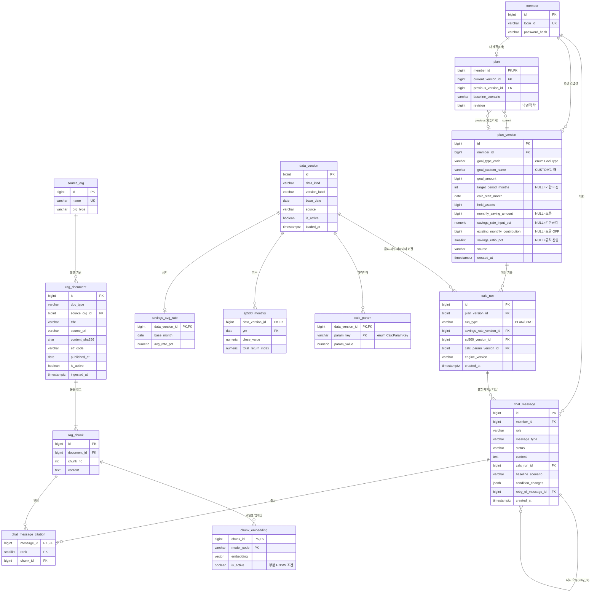

# 최종 ERD v2 — 최소 저장 원칙

- 이전 버전: `final/v1/erd.md` (채택안 B v2 + 병합 5건, 테이블 25개). 결정 기록은 `final/decision.md`의 ADR-002.
- 실행 DDL: `final/schema.sql`. 아래 §2와 같은 내용이다.
- DB에서 코드로 옮긴 것: `final/moved-to-code.md`. 테이블별 저장 이유: `final/tables.md`.

## 변경 요약 (v1 → v2)

| 구분 | v1 | v2 |
|---|---|---|
| 테이블 | 25 | **14** |
| 트리거 | 6 | **0** |
| 생성 컬럼 | 10 | **0** |
| 다중 컬럼 FK | 다수(소유권·종류 일치·복사값 일치) | **0** |
| 인증 | `user_session` 서버 세션 | 무상태 JWT (DB 저장 없음) |

저장 기준은 세 가지다.
1. 사용자가 만든 원본 데이터: `member`, `plan_version`, `plan`, `chat_message`
2. 외부에서 가져온 시점 데이터: `data_version`, `savings_avg_rate`, `sp500_monthly`, `calc_param`, `source_org`, `rag_document`, `rag_chunk`, `chunk_embedding`
3. 다른 테이블이 참조해야 하는 최소 기록: `calc_run`, `chat_message_citation`

- 삭제한 테이블 11개: `user_session`, `input_field`, `change_path`, `change_path_field`, `goal_type`, `calc_param_key`, `embedding_model`, `plan_application`, `calc_run_override`, `calc_scenario_result`, `calc_alternative`
- 계산 결과는 저장하지 않는다. `calc_run`에 기록된 계획 버전, 기준 데이터 버전, `engine_version`으로 언제든 같은 결과를 다시 계산한다.

---

## 1. Mermaid erDiagram



---

## 2. DDL (PostgreSQL 16 + pgvector)

```sql
-- =====================================================================
-- final/schema.sql — 최소 저장 원칙 v2 (이전 버전: final/v1/schema.sql)
-- 대상: PostgreSQL 16 + pgvector. 빈 DB에서 이 파일 전체를 순서대로 실행한다.
--
-- 저장 대상: (1) 사용자가 만든 원본 데이터 (2) 외부에서 가져온 시점 데이터
--            (3) 다른 테이블이 참조해야 하는 최소 기록
-- 무결성: PK / FK / NOT NULL / UNIQUE / 단순 CHECK 만 사용한다.
--         트리거·생성 컬럼·복사값 일치용 복합 FK는 쓰지 않는다.
--         소유권은 앱이 모든 쿼리에 member_id 조건을 붙여 검증한다.
-- 코드로 옮긴 규칙·코드표·결과: final/moved-to-code.md
-- =====================================================================

CREATE EXTENSION IF NOT EXISTS vector;

-- =========================================================
-- 사용자 (FR-AUTH-01, NFR-SEC-01). 인증은 무상태 JWT라 세션 테이블이 없다.
-- =========================================================
CREATE TABLE member (
    id             BIGSERIAL    PRIMARY KEY,
    login_id       VARCHAR(50)  NOT NULL,
    password_hash  VARCHAR(255) NOT NULL,                 -- bcrypt/argon2 결과
    CONSTRAINT uq_member_login_id UNIQUE (login_id)
);

-- =========================================================
-- 기준 데이터와 버전 (FR-DATA-*, CP-03, NFR-INT-02) — 외부 시점 데이터
-- =========================================================
CREATE TABLE data_version (
    id             BIGSERIAL    PRIMARY KEY,
    data_kind      VARCHAR(20)  NOT NULL,
    version_label  VARCHAR(50)  NOT NULL,
    base_date      DATE         NOT NULL,
    source         VARCHAR(100) NOT NULL,
    is_active      BOOLEAN      NOT NULL DEFAULT FALSE,
    loaded_at      TIMESTAMPTZ  NOT NULL DEFAULT now(),
    CONSTRAINT ck_data_kind CHECK (data_kind IN ('SAVINGS_RATE','SP500','CALC_PARAM')),
    CONSTRAINT uq_data_version_label UNIQUE (data_kind, version_label)
);
CREATE UNIQUE INDEX uq_data_version_active ON data_version (data_kind) WHERE is_active;  -- 종류별 활성 버전 1개

CREATE TABLE savings_avg_rate (
    data_version_id  BIGINT       PRIMARY KEY REFERENCES data_version(id),
    base_month       DATE         NOT NULL,
    avg_rate_pct     NUMERIC(6,3) NOT NULL,
    CONSTRAINT ck_sar_rate        CHECK (avg_rate_pct >= 0),
    CONSTRAINT ck_sar_month_first CHECK (EXTRACT(DAY FROM base_month) = 1)
);

CREATE TABLE sp500_monthly (
    data_version_id     BIGINT        NOT NULL REFERENCES data_version(id),
    ym                  DATE          NOT NULL,
    close_value         NUMERIC(14,4) NOT NULL,
    total_return_index  NUMERIC(18,6),
    PRIMARY KEY (data_version_id, ym),
    CONSTRAINT ck_sp500_close CHECK (close_value > 0)
);

CREATE TABLE calc_param (
    data_version_id  BIGINT        NOT NULL REFERENCES data_version(id),
    param_key        VARCHAR(50)   NOT NULL,              -- 앱 enum CalcParamKey
    param_value      NUMERIC(14,6) NOT NULL,
    PRIMARY KEY (data_version_id, param_key)
);

-- =========================================================
-- 내 계획 (FR-INP-*, FR-PLAN-*) — 사용자 원본 데이터
-- =========================================================
CREATE TABLE plan_version (
    id                             BIGSERIAL    PRIMARY KEY,
    member_id                      BIGINT       NOT NULL REFERENCES member(id) ON DELETE CASCADE,
    goal_type_code                 VARCHAR(30)  NOT NULL,   -- 앱 enum GoalType
    goal_custom_name               VARCHAR(50),             -- GoalType.CUSTOM일 때만 (앱 검증)
    goal_amount                    BIGINT       NOT NULL,
    target_period_months           INT,                     -- NULL = 기한 미정
    calc_start_month               DATE         NOT NULL,
    held_assets                    BIGINT       NOT NULL DEFAULT 0,
    monthly_saving_amount          BIGINT,                  -- NULL = '잘 모르겠어요'
    savings_rate_input_pct         NUMERIC(6,3),            -- NULL = 기본금리
    existing_monthly_contribution  BIGINT,                  -- NULL = 토글 OFF
    savings_ratio_pct              SMALLINT,                -- NULL = 규칙으로 산출(토글/기본값). 사용자가 직접 정한 비중만 저장
    source                         VARCHAR(20)  NOT NULL,   -- 이 버전을 만든 경로
    created_at                     TIMESTAMPTZ  NOT NULL DEFAULT now(),
    CONSTRAINT ck_pv_goal_amount CHECK (goal_amount > 0),
    CONSTRAINT ck_pv_period      CHECK (target_period_months IS NULL OR target_period_months > 0),
    CONSTRAINT ck_pv_amounts     CHECK (held_assets >= 0
                                        AND (monthly_saving_amount IS NULL OR monthly_saving_amount >= 0)
                                        AND (existing_monthly_contribution IS NULL OR existing_monthly_contribution >= 0)),
    CONSTRAINT ck_pv_rate        CHECK (savings_rate_input_pct IS NULL OR savings_rate_input_pct >= 0),
    CONSTRAINT ck_pv_ratio       CHECK (savings_ratio_pct IS NULL OR savings_ratio_pct BETWEEN 0 AND 100),
    CONSTRAINT ck_pv_source      CHECK (source IN ('INPUT','ALTERNATIVE','COMPARE','CHAT'))
);
CREATE INDEX ix_plan_version_member ON plan_version (member_id);

CREATE TABLE plan (
    member_id            BIGINT      PRIMARY KEY REFERENCES member(id) ON DELETE CASCADE,
    current_version_id   BIGINT      NOT NULL REFERENCES plan_version(id),
    previous_version_id  BIGINT      REFERENCES plan_version(id),   -- 되돌리기 대상(직전 1단계)
    baseline_scenario    VARCHAR(10) NOT NULL,
    revision             BIGINT      NOT NULL DEFAULT 1,            -- 낙관적 락: UPDATE ... WHERE revision = $expected
    CONSTRAINT ck_plan_baseline  CHECK (baseline_scenario IN ('GOOD','AVG','BAD')),
    CONSTRAINT ck_plan_prev_diff CHECK (previous_version_id IS NULL OR previous_version_id <> current_version_id),
    CONSTRAINT ck_plan_revision  CHECK (revision >= 1)
);

-- =========================================================
-- 계산 기록 (NFR-INT-01/02) — 결과는 저장하지 않고 "무엇으로 계산했는지"만 남긴다
-- PLAN: 내 계획 계산. CHAT: chat_message가 참조하는 대화 재계산. COMPARE는 저장하지 않는다.
-- =========================================================
CREATE TABLE calc_run (
    id                       BIGSERIAL    PRIMARY KEY,
    plan_version_id          BIGINT       NOT NULL REFERENCES plan_version(id) ON DELETE CASCADE,
    run_type                 VARCHAR(10)  NOT NULL,
    savings_rate_version_id  BIGINT       REFERENCES data_version(id),   -- NULL = 기본금리를 쓰지 않음
    sp500_version_id         BIGINT       REFERENCES data_version(id),   -- NULL = ETF 비중 0%
    calc_param_version_id    BIGINT       NOT NULL REFERENCES data_version(id),
    engine_version           VARCHAR(20)  NOT NULL,
    created_at               TIMESTAMPTZ  NOT NULL DEFAULT now(),
    CONSTRAINT ck_cr_run_type CHECK (run_type IN ('PLAN','CHAT'))
);
CREATE INDEX ix_calc_run_latest ON calc_run (plan_version_id, run_type, created_at DESC);

-- =========================================================
-- RAG 자료 (FR-AI-03, FR-AI-10, NFR-INT-04) — 외부 시점 데이터. 이용 허락된 문서만 적재한다
-- =========================================================
CREATE TABLE source_org (
    id        BIGSERIAL    PRIMARY KEY,
    name      VARCHAR(100) NOT NULL,
    org_type  VARCHAR(20)  NOT NULL,
    CONSTRAINT uq_source_org_name UNIQUE (name),
    CONSTRAINT ck_source_org_type CHECK (org_type IN ('ASSET_MANAGER','EDU_PROVIDER','REGULATOR'))
);

CREATE TABLE rag_document (
    id              BIGSERIAL     PRIMARY KEY,
    doc_type        VARCHAR(20)   NOT NULL,
    source_org_id   BIGINT        NOT NULL REFERENCES source_org(id),
    title           VARCHAR(300)  NOT NULL,
    source_url      VARCHAR(1000) NOT NULL,
    content_sha256  CHAR(64)      NOT NULL,              -- 같은 URL의 개정본은 새 행
    etf_code        VARCHAR(20),
    published_at    DATE,
    is_active       BOOLEAN       NOT NULL DEFAULT TRUE, -- 검색 제외용. 과거 인용 보존을 위해 행은 지우지 않는다
    ingested_at     TIMESTAMPTZ   NOT NULL DEFAULT now(),
    CONSTRAINT uq_rag_document_rev UNIQUE (source_url, content_sha256),
    CONSTRAINT ck_rag_doc_type CHECK (doc_type IN ('EDU','DISCLOSURE'))
);

CREATE TABLE rag_chunk (
    id           BIGSERIAL PRIMARY KEY,
    document_id  BIGINT    NOT NULL REFERENCES rag_document(id) ON DELETE CASCADE,
    chunk_no     INT       NOT NULL,
    content      TEXT      NOT NULL,
    CONSTRAINT uq_rag_chunk_doc_no UNIQUE (document_id, chunk_no)
);

CREATE TABLE chunk_embedding (
    chunk_id    BIGINT       NOT NULL REFERENCES rag_chunk(id) ON DELETE CASCADE,
    model_code  VARCHAR(50)  NOT NULL,                   -- 임베딩 모델 식별 문자열
    embedding   vector(1536) NOT NULL,
    is_active   BOOLEAN      NOT NULL DEFAULT TRUE,      -- 부분 HNSW 조건. rag_document.is_active와 같은 트랜잭션에서 앱이 함께 갱신
    PRIMARY KEY (chunk_id, model_code)
);
CREATE INDEX ix_chunk_embedding_hnsw ON chunk_embedding
    USING hnsw (embedding vector_cosine_ops) WITH (m = 16, ef_construction = 64)
    WHERE is_active;

-- =========================================================
-- AI 대화 (FR-AI-01~09) — 영속 저장. AI 출력은 다시 만들 수 없으므로 원본으로 취급한다
-- =========================================================
CREATE TABLE chat_message (
    id                   BIGSERIAL    PRIMARY KEY,
    member_id            BIGINT       NOT NULL REFERENCES member(id) ON DELETE CASCADE,
    role                 VARCHAR(10)  NOT NULL,
    message_type         VARCHAR(20)  NOT NULL,
    status               VARCHAR(10)  NOT NULL DEFAULT 'COMPLETED',
    content              TEXT,
    calc_run_id          BIGINT       REFERENCES calc_run(id),
    baseline_scenario    VARCHAR(10),                    -- 설명·재계산 당시 기준 시나리오
    condition_changes    JSONB,                          -- 인식한 변경 의도. RECALC_RESULT에서는 재계산에 쓴 바꾼 값
    retry_of_message_id  BIGINT       REFERENCES chat_message(id),
    created_at           TIMESTAMPTZ  NOT NULL DEFAULT now(),
    CONSTRAINT ck_cm_role      CHECK (role IN ('USER','ASSISTANT')),
    CONSTRAINT ck_cm_type      CHECK (message_type IN ('QUESTION','ANSWER','EXPLANATION','RECALC_RESULT','CLARIFY','OUT_OF_SCOPE','FAILURE')),
    CONSTRAINT ck_cm_role_type CHECK ((role = 'USER') = (message_type = 'QUESTION')),
    CONSTRAINT ck_cm_status    CHECK (status IN ('PENDING','COMPLETED','FAILED')),
    CONSTRAINT ck_cm_content   CHECK (status = 'PENDING' OR content IS NOT NULL),
    CONSTRAINT ck_cm_baseline  CHECK (baseline_scenario IS NULL OR baseline_scenario IN ('GOOD','AVG','BAD')),
    CONSTRAINT ck_cm_changes   CHECK (condition_changes IS NULL OR jsonb_typeof(condition_changes) = 'object'),
    CONSTRAINT ck_cm_recalc    CHECK (message_type <> 'RECALC_RESULT'
                                      OR (calc_run_id IS NOT NULL AND condition_changes IS NOT NULL AND baseline_scenario IS NOT NULL)),
    CONSTRAINT ck_cm_explain   CHECK (message_type <> 'EXPLANATION' OR (calc_run_id IS NOT NULL AND baseline_scenario IS NOT NULL)),
    CONSTRAINT ck_cm_out_of_scope CHECK (message_type <> 'OUT_OF_SCOPE' OR calc_run_id IS NULL)
);
CREATE INDEX ix_chat_message_member ON chat_message (member_id, id);                       -- 대화 복원·폴링 키셋
CREATE INDEX ix_chat_message_pending ON chat_message (created_at) WHERE status = 'PENDING';
CREATE INDEX ix_chat_message_run ON chat_message (calc_run_id) WHERE calc_run_id IS NOT NULL;

CREATE TABLE chat_message_citation (
    message_id  BIGINT   NOT NULL REFERENCES chat_message(id) ON DELETE CASCADE,
    rank        SMALLINT NOT NULL,
    chunk_id    BIGINT   NOT NULL REFERENCES rag_chunk(id),
    PRIMARY KEY (message_id, rank),
    CONSTRAINT uq_citation_chunk UNIQUE (message_id, chunk_id)
);
```

---

## 3. 요구사항 추적표 (68건)

"코드"는 DB가 아니라 앱이 맡는다는 뜻이며, 구체적인 위치(enum, 설정 키, 함수, 로그)는 `moved-to-code.md`에 같은 REQ-ID로 적었다.

| REQ-ID | DB (테이블 / 컬럼) | 코드 (`moved-to-code.md`) |
|---|---|---|
| CP-01 | `plan_version`(내 계획·조건 항목·보유 자산), `plan.baseline_scenario`(기준 시나리오) | `CalcEngine` 결과(3구간·평균·세후 예상 자산·목표 대비·달성/미달·도달 시점, 0원 = 달성) |
| CP-02 | `plan_version` 단순 CHECK(음수 금지, 비중 0~100) | `InputField` + `rules.yml › input.fields`, `ConditionValidator` |
| CP-03 | `calc_param`, `savings_avg_rate`, `sp500_monthly`, `plan_version.calc_start_month`, `calc_run.*_version_id` | `ConditionResolver`, `CalcParamKey` |
| CP-04 | 금액 BIGINT, 기간 개월 INT, 비중 정수 % | `Formatter` |
| CP-05 | — | `copy/copy.ko.yml` |
| CP-06 | 상품·종목 테이블 없음 | `rules.yml › change-paths`(상품 선택 없음), 문구표·프롬프트 |
| CP-07 | — | `ChangePath` + `rules.yml › change-paths.<PATH>.{fields,max-fields}`, `ConditionValidator` |
| FR-AI-01 | `chat_message.status`(PENDING→COMPLETED), `ix_chat_message_pending` | 비동기 호출 |
| FR-AI-02 | `chat_message.calc_run_id` → `calc_run`(계획 버전 + 데이터 버전 + engine_version), `chat_message.baseline_scenario` | `CalcEngine` 재계산(결정적) |
| FR-AI-03 | `chat_message_citation` → `rag_chunk` → `rag_document.source_org_id` → `source_org.org_type` | `RagIngestor`(공시는 운용사만), 게시 직전 운용사 2곳 검증 |
| FR-AI-04 | `chat_message.status='FAILED'`, `message_type='FAILURE'`, `content` | 로그 `ai.attempt.error` |
| FR-AI-05 | `chat_message.retry_of_message_id` | 로그 `ai.attempt` |
| FR-AI-06 | `chat_message.condition_changes`, `message_type='CLARIFY'` | `ChangePath.CHAT`, `ConditionValidator` |
| FR-AI-07 | `calc_run(run_type='CHAT')`, `chat_message(message_type='RECALC_RESULT', condition_changes)` | `CalcEngine` |
| FR-AI-08 | — | 질문 예시 문구 `copy.ko.yml`, 로그 `ai.question` |
| FR-AI-09 | `message_type='OUT_OF_SCOPE'`(계산 기록 없음) | `rules.yml › change-paths.CHAT.fields` |
| FR-AI-10 | `rag_document`, `rag_chunk`, `chunk_embedding`, `chat_message_citation` | `RagIngestor`(허락 문서만) |
| FR-ALT-01 | — | `AlternativeFinder`(기준 시나리오 미달일 때만) |
| FR-ALT-02 | — | `AlternativeFinder`(3종, UNAVAILABLE 카드 포함) |
| FR-ALT-03 | `calc_param`(ALT_STEP_*) | `AlternativeFinder`(조건 하나만 변경) |
| FR-ALT-04 | 적용 시 `plan_version(source='ALTERNATIVE')` + `plan` | 비교는 요청마다 계산 |
| FR-AUTH-01 | `member.login_id`, `password_hash` | 로그 `auth.login` |
| FR-AUTH-02 | — | `JwtTokenService`(30분), `TokenRenewalFilter`(조작 요청만 재발급) |
| FR-AUTH-03 | — | 클라이언트 토큰 삭제 |
| FR-CMP-01 | — | `CalcEngine`(비중별 3구간 = 위험 범위) |
| FR-CMP-02 | — | 요청 본문 `ConditionOverride`, `ConditionValidator(COMPARE)` |
| FR-CMP-03 | — | 프론트 상태 초기화 |
| FR-DATA-01 | `data_version(SAVINGS_RATE)`, `savings_avg_rate` | |
| FR-DATA-02 | `data_version(SP500)`, `sp500_monthly` | |
| FR-INP-01 | `plan_version.goal_type_code` | enum `GoalType` |
| FR-INP-02 | `plan_version.goal_custom_name` | `GoalType.CUSTOM`, `PlanInputValidator` |
| FR-INP-03 | `plan_version.goal_amount NOT NULL > 0` | |
| FR-INP-04 | `plan_version.target_period_months`(NULL = 기한 미정) | |
| FR-INP-05 | `plan_version.held_assets` | |
| FR-INP-06 | `plan_version.monthly_saving_amount`(NULL = 모름) | |
| FR-INP-07 | `plan_version.savings_rate_input_pct`(NULL = 기본), `calc_run.savings_rate_version_id` | `ConditionResolver` |
| FR-INP-08 | `plan_version.existing_monthly_contribution`(1개), `savings_ratio_pct`(직접 정한 비중만) | `RatioResolver`, `calc_param.DEFAULT_SAVINGS_RATIO` |
| FR-INP-09 | `plan_version` 단순 CHECK | `ConditionValidator(INPUT_EDIT)`, `PlanInputValidator` |
| FR-INP-10 | `plan_version` INSERT + `plan` + `calc_run(PLAN)` (Q4-a) | |
| FR-INP-11 | `plan.current_version_id` → `plan_version` | |
| FR-PLAN-01 | `plan.revision`(확인 시점 값) | 바뀌는 내용은 `ConditionOverride`와 현재 버전의 차이로 표시 |
| FR-PLAN-02 | 쓰기 없음 | |
| FR-PLAN-03 | `plan_version` INSERT + `plan` UPDATE `WHERE revision = $expected` (Q4-b) | 로그 `plan.changed` |
| FR-PLAN-04 | `plan.previous_version_id` (Q4-c) | 로그 `plan.changed(UNDO)` |
| FR-PLAN-05 | `plan`, `plan_version` 영속, `calc_run` 최신 기록과 활성 `data_version` 비교 (Q1) | `CalcEngine` 재계산 |
| FR-PLAN-06 | `plan` 행 존재 여부 | |
| FR-RES-01 | `plan_version.held_assets`, `goal_amount` | `CalcEngine`(보유 ≥ 목표 → AlreadyExceeded) |
| FR-RES-02 | `plan.baseline_scenario`, 최신 `calc_run(PLAN)` | `CalcEngine` |
| FR-RES-03 | — | `CalcEngine`(비중 < 100이면 3구간) |
| FR-RES-04 | `plan_version.calc_start_month` | `CalcEngine` 월별 시계열 |
| FR-RES-05 | `plan.current_version_id` → `plan_version` | `Formatter` |
| FR-RES-06 | `calc_param`, `data_version`(라벨·기준일·출처) | `copy.ko.yml › assumption.<KEY>` |
| FR-RES-07 | — | `copy.ko.yml › disclaimer` |
| FR-RES-08 | `plan_version.monthly_saving_amount IS NULL` | `CalcEngine.requiredMonthlySaving` |
| FR-RES-09 | `plan.baseline_scenario`, `chat_message.baseline_scenario` | `CalcEngine` 판정 |
| NFR-AVL-01 | — | 운영 |
| NFR-CMP-01 | — | 프론트 |
| NFR-CMP-02 | — | 프론트 |
| NFR-INT-01 | `calc_run.engine_version` | `CalcEngine`(Spring) |
| NFR-INT-02 | `calc_run.savings_rate_version_id`, `sp500_version_id`, `calc_param_version_id`, `engine_version` | `DataVersionService.requireKind` |
| NFR-INT-03 | `chat_message.calc_run_id` | FastAPI → Spring `POST /calc` |
| NFR-INT-04 | `chunk_embedding.embedding` + 부분 HNSW `ix_chunk_embedding_hnsw` | `rag.embedding.*` 설정 |
| NFR-PERF-01 | §4 인덱스 | 결과 캐시(앱 메모리), 로그 `*.latencyMs` |
| NFR-SEC-01 | `member.password_hash` | |
| NFR-SEC-02 | — | `JwtTokenService.verify`(서명·exp), 모든 쿼리 `member_id` 조건 |
| NFR-UI-01 | — | 프론트 |
| NFR-USA-01 | `chat_message.member_id`(계획 없이도 대화) | 문구표·프롬프트 |
| NFR-USA-02 | — | 문구표·프롬프트 |

---

## 4. 주요 쿼리와 인덱스 근거

요청 빈도는 **대화 폴링 ≫ 결과 화면 ≫ 비교 재계산 ≫ 적용/되돌리기 ≫ RAG 검색** 순이다. 인증은 JWT 서명 검증이라 DB를 조회하지 않는다. 비교 재계산은 DB를 읽기만 하고 쓰지 않는다.

### Q1. 로그인 직후 진입 + 결과 화면 (FR-PLAN-05/06, FR-RES-02~06)

```sql
-- (a) 계획과 현재 조건, 최신 PLAN 계산 기록
SELECT p.baseline_scenario, p.revision, p.previous_version_id, v.*, r.*
FROM plan p
JOIN plan_version v ON v.id = p.current_version_id
LEFT JOIN LATERAL (
    SELECT id, savings_rate_version_id, sp500_version_id, calc_param_version_id, engine_version
    FROM calc_run
    WHERE plan_version_id = p.current_version_id AND run_type = 'PLAN'
    ORDER BY created_at DESC LIMIT 1) r ON true
WHERE p.member_id = $user;                       -- 0행이면 빈 입력 화면 (FR-PLAN-06)

-- (b) 현재 활성 기준 데이터 버전 (3행)
SELECT data_kind, id FROM data_version WHERE is_active;

-- (c) 최신 기록의 버전이 (b)나 현재 engine_version과 다르면 최신 데이터로 다시 계산하고 기록 (FR-PLAN-05)
INSERT INTO calc_run (plan_version_id, run_type, savings_rate_version_id, sp500_version_id, calc_param_version_id, engine_version)
VALUES ($current_version, 'PLAN', $rate_ver, $sp_ver, $param_ver, $engine);
```

- `plan`은 PK, `plan_version`도 PK로 조회한다. `ix_calc_run_latest (plan_version_id, run_type, created_at DESC)`로 최신 기록 1행을 인덱스 첫 항목에서 바로 읽는다.
- `uq_data_version_active`(부분 UNIQUE)는 종류별 1행을 보장하고, (b)는 최대 3행이다.
- 결과 값은 `CalcEngine`이 기록된 버전의 `savings_avg_rate`·`sp500_monthly`·`calc_param`을 PK 범위로 읽어 계산한다. 같은 버전 조합의 기준 데이터는 앱 메모리에 캐시한다. 기준 데이터는 불변이라 캐시를 무효화할 필요가 없다.

### Q2. 대화 복원과 폴링 (FR-AI-01/04/05/07)

```sql
-- (a) 복원: 최신 50개 (키셋 페이지)
SELECT id, role, message_type, status, content, calc_run_id, baseline_scenario, condition_changes, retry_of_message_id, created_at
FROM chat_message WHERE member_id = $user AND id < $before ORDER BY id DESC LIMIT 50;

-- (b) 폴링: 마지막으로 본 id 이후 새 메시지 + 아직 PENDING이던 메시지의 상태
SELECT id, status, content FROM chat_message
WHERE member_id = $user AND (id > $last_seen OR id = ANY($pending_ids));

-- (c) 출처 일괄 조회
SELECT c.message_id, c.rank, d.title, d.source_url, o.name
FROM chat_message_citation c
JOIN rag_chunk ch ON ch.id = c.chunk_id
JOIN rag_document d ON d.id = ch.document_id
JOIN source_org o ON o.id = d.source_org_id
WHERE c.message_id = ANY($message_ids) ORDER BY c.message_id, c.rank;
```

- `ix_chat_message_member (member_id, id)`가 (a)의 키셋과 (b)의 `id > $last_seen` 범위를 맡는다. `pending_ids`는 PK로 조회한다. 폴링 요청은 토큰을 재발급하지 않아 30분 비활동 판정에 영향을 주지 않는다.
- 재계산 결과 메시지를 다시 보여줄 때는 `calc_run` 기록, 그 계획 버전, `condition_changes`로 다시 계산한다. 대화창에는 AI가 쓴 `content`를 그대로 보여주므로 다시 계산하는 것은 그래프와 숫자 카드뿐이다.

### Q3. RAG 검색과 출처 검증 (FR-AI-03, FR-AI-10, NFR-INT-04)

```sql
SET hnsw.ef_search = 100;
SET hnsw.iterative_scan = relaxed_order;   -- pgvector 0.8+: 필터로 결과가 모자라면 인덱스 탐색을 이어간다

-- (a) ETF 위험 설명: 공시만. 운용사가 2곳 미만이면 찾은 운용사를 빼고 한 번 더
SELECT e.chunk_id, ch.content, d.source_org_id, d.title, d.source_url
FROM chunk_embedding e
JOIN rag_chunk ch    ON ch.id = e.chunk_id
JOIN rag_document d  ON d.id = ch.document_id
WHERE e.is_active AND e.model_code = $model
  AND d.doc_type = 'DISCLOSURE' AND d.source_org_id <> ALL($found_org_ids)
ORDER BY e.embedding <=> $q LIMIT 5;

-- (b) 게시 직전 검증: 공시 인용의 서로 다른 운용사 수
SELECT count(DISTINCT d.source_org_id) >= 2 AS ok
FROM chat_message_citation c
JOIN rag_chunk ch ON ch.id = c.chunk_id
JOIN rag_document d ON d.id = ch.document_id
WHERE c.message_id = $msg AND d.doc_type = 'DISCLOSURE';
```

- 부분 HNSW `ix_chunk_embedding_hnsw ... WHERE is_active`가 ANN 단계에서 비활성 문서를 뺀다. `doc_type`·`source_org_id`는 조인 뒤 필터이므로 `iterative_scan`으로 결과 부족을 보충한다. 이 트레이드오프는 §5-E에 있다.
- 조인은 LIMIT 근처의 후보 행에 대해 PK(`rag_chunk.id`, `rag_document.id`)로만 수행한다.

### Q4. 계획 저장 / 적용 / 되돌리기 (FR-INP-10, FR-PLAN-01~04)

```sql
-- (a) 최초 저장 (FR-INP-10)
BEGIN;
INSERT INTO plan_version (member_id, goal_type_code, ..., source) VALUES ($user, ..., 'INPUT') RETURNING id;   -- :v
INSERT INTO plan (member_id, current_version_id, baseline_scenario) VALUES ($user, :v, 'AVG')
    ON CONFLICT (member_id) DO UPDATE
    SET previous_version_id = plan.current_version_id, current_version_id = EXCLUDED.current_version_id,
        revision = plan.revision + 1;                      -- 입력 수정 저장도 같은 경로
INSERT INTO calc_run (plan_version_id, run_type, ...) VALUES (:v, 'PLAN', ...);
COMMIT;

-- (b) 대안·비교·대화 결과 적용 (FR-PLAN-03): 확인창을 연 시점의 revision으로 갱신
BEGIN;
INSERT INTO plan_version (...) VALUES (..., $source) RETURNING id;                                         -- :v
UPDATE plan SET previous_version_id = current_version_id, current_version_id = :v, revision = revision + 1
WHERE member_id = $user AND revision = $expected;            -- 0행이면 ROLLBACK (중복 전송·동시 수정)
INSERT INTO calc_run (plan_version_id, run_type, ...) VALUES (:v, 'PLAN', ...);
COMMIT;

-- (c) 되돌리기 (FR-PLAN-04): 직전 1단계로. 토스트가 들고 있는 revision이 토큰 역할
UPDATE plan SET current_version_id = previous_version_id, previous_version_id = NULL, revision = revision + 1
WHERE member_id = $user AND revision = $toast_revision AND previous_version_id IS NOT NULL;
```

- 모두 `plan` PK로 갱신한다. `revision` 조건 하나로 중복 전송, 동시 수정, 오래된 되돌리기 토큰을 막는다. v1의 `plan_application`·`request_key`·트리거가 맡던 역할이다.
- 되돌린 뒤에는 `previous_version_id = NULL`이라 다시 되돌릴 수 없다. "직전 계획 1개"(FR-PLAN-04) 요구와 같다.
- 되돌린 버전의 결과는 Q1과 같은 방식으로 최신 `calc_run`을 읽어 다시 계산한다.

---

## 5. 설계 결정과 트레이드오프

### A. 결과는 저장하지 않고 다시 계산한다
- **선택:** `calc_run`에는 계획 버전, 기준 데이터 버전 3종, `engine_version`만 남긴다. 결과·시계열·대안은 화면을 열 때 `CalcEngine`이 다시 만든다.
- **얻은 것:** 결과 테이블 3개, 이를 지키던 트리거 2개, 복합 FK 4개가 사라졌다. 결과와 입력이 어긋날 수 있는 경로 자체가 없다.
- **포기한 것:** 화면을 열 때마다 계산 비용이 든다. 계산 규모는 최대 360개월 × 3시나리오 + 대안 3종이다. 버전 조합 단위의 앱 캐시로 완화한다. 또 결과의 재현성이 엔진의 결정성과 `engine_version` 관리에 달려 있다. 계산 로직을 바꾸고 버전을 올리지 않으면 과거 설명(FR-AI-02)과 다시 계산한 숫자가 어긋난다. 엔진 테스트에 "같은 입력 + 같은 버전 → 같은 결과" 회귀 테스트를 둔다.

### B. COMPARE는 저장하지 않고, CHAT은 참조될 때만 남긴다
- 비교는 화면 안의 일시 계산이다. 적용하면 새 `plan_version(source='COMPARE')`이 만들어지므로 원본 실행을 가리킬 필요가 없다.
- 대화 재계산은 AI 메시지가 그 결과를 설명하므로 `calc_run(CHAT)` 1행을 남긴다. 바꾼 값은 `chat_message.condition_changes`에 있다(`ck_cm_recalc`로 필수).

### C. 계획 이력은 버전 행 + 포인터 2개 + revision
- `plan_version`은 INSERT만 한다. `plan`의 `current`와 `previous`로 현재 계획과 직전 1단계를 가리킨다.
- 출처는 `plan_version.source`로 충분하다. 적용·되돌리기 이벤트 감사는 로그 `plan.changed`로 옮겼다.
- **포기한 것:** "언제 되돌렸는가"를 DB 질의로 볼 수 없다. 데모 범위에서 이 질의를 요구하는 기능은 없다.

### D. 비중(FR-INP-08)은 사용자가 정한 값만 저장한다
- `savings_ratio_pct`가 NULL이면 `RatioResolver`가 다음 순서로 정한다.
  1. 기존 납입액이 있으면 `existing_monthly_contribution / monthly_saving_amount`
  2. 없으면 `calc_param.DEFAULT_SAVINGS_RATIO`
- 기본 비중이 버전 데이터(`calc_param`)에 있으므로, 기본값이 바뀌어도 과거 `calc_run`은 당시 파라미터 버전으로 같은 결과를 낸다.
- 대안·비교·대화로 비중을 바꿔 적용하면 그 값을 `savings_ratio_pct`에 저장하고, 이 값이 토글 산출값보다 우선한다.

### E. RAG 반정규화는 `chunk_embedding.is_active` 하나만 둔다
- **이유:** HNSW는 부분 인덱스의 WHERE 조건을 같은 테이블의 컬럼으로만 걸 수 있다. 비활성 문서가 인덱스에 남으면 ANN 상위 결과를 비활성 행이 차지해 결과가 비게 된다. 이용 허락 철회가 이 경우다. 그래서 `is_active`만은 임베딩 행에 둔다.
- **동기화:** 문서를 비활성화할 때 앱이 같은 트랜잭션에서 `rag_document`와 `chunk_embedding`을 함께 UPDATE한다. FK가 맞춰 주지 않으므로 적재 스크립트에 정합성 점검 쿼리를 둔다.
- **포기한 것:** `doc_type`·`source_org_id` 필터가 ANN 이후로 밀린다. 공시만 찾는 검색(Q3-a)은 `iterative_scan`과 재검색에 의존한다. 자료 규모(데모, 수천 청크)에서는 영향이 작다고 판단했다. 공시 비중이 매우 작아 결과가 모자라면 `doc_type` 반정규화를 다시 검토한다.

### F. 무결성 범위
- DB에는 PK/FK/NOT NULL/UNIQUE와 한 행 안의 단순 CHECK만 둔다.
  - 단순 CHECK 예: 음수 금지, 비중 0~100, SRS가 고정한 값 목록(3구간, 메시지 역할·유형)
- 바뀔 수 있는 규칙은 앱이 맡는다. 입력 범위(TBD-09), 경로별 허용 항목, 목표 종류 목록, 직접 입력 시 목표명 필수 같은 것들이다. 이런 규칙을 CHECK에 넣으면 enum과 DB 두 곳을 같이 고쳐야 한다.
- 소유권은 모든 리포지토리 쿼리에 `member_id` 조건을 붙여 검증한다. `calc_run`과 `chat_message_citation`은 각각 `plan_version`과 `chat_message`를 거쳐 사용자에 닿는다.

### G. 인증은 무상태 JWT
- 액세스 토큰 만료는 30분이다. 사용자 조작 요청에는 새 토큰을 내려 30분 비활동 만료를 구현한다(슬라이딩). 폴링에는 재발급하지 않는다.
- 로그아웃은 클라이언트가 토큰을 지우는 것으로 처리한다.
- **포기한 것:** 서버 측 강제 로그아웃과 토큰 폐기. 로그아웃 후에도 탈취된 토큰은 남은 만료 시간(최대 30분) 동안 유효하다. NFR-SEC-02 "서버에서 관리"는 "서명과 만료를 서버가 검증한다"로 재해석했다(사용자 확인을 받음). 상세는 ADR-002.

### H. 로그로 보낸 것
- AI 시도 버전(prompt/model/copy), 질문 입력 경로, 실패 코드, 응답 시간, 최근 로그인, 계획 변경 이벤트.
- SRS가 DB 저장을 요구하지 않고, 대화 복원과 계산에 쓰이지 않는다. 근거는 `moved-to-code.md`의 '판단 근거'에 있다.

---

## 검증 결과

**환경:** `pgvector/pgvector:pg16` 임시 컨테이너. 검증 뒤 삭제했다.

| 항목 | 결과 |
|---|---|
| `final/schema.sql` 전체를 `ON_ERROR_STOP=1`로 실행 | 오류 없음 |
| 테이블 / 트리거 / 생성 컬럼 / 다중 컬럼 FK 수 | 14 / 0 / 0 / 0 |
| 계획 저장 → PLAN·CHAT 실행 기록 → 재계산 메시지 | 성공, 최신 PLAN 실행 조회 정상 |
| `run_type='COMPARE'` INSERT | `ck_cr_run_type` 위반으로 거부 |
| `condition_changes` 없는 RECALC_RESULT | `ck_cm_recalc` 위반으로 거부 |
| 같은 종류의 활성 버전 2개 | `uq_data_version_active` 위반으로 거부 |
| `previous_version_id = current_version_id` | `ck_plan_prev_diff` 위반으로 거부 |
| 사용자 삭제 | 계획·버전·계산 기록·대화 CASCADE, 잔여 0행 |
| 요구사항 추적 | SRS 68건 모두 §3에 있고, '코드' 열의 항목은 `moved-to-code.md`에 같은 REQ-ID가 있다 (스크립트로 확인) |
